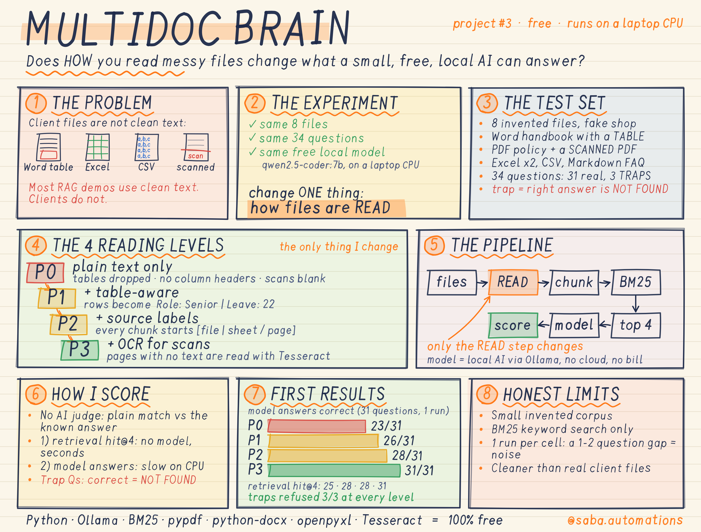
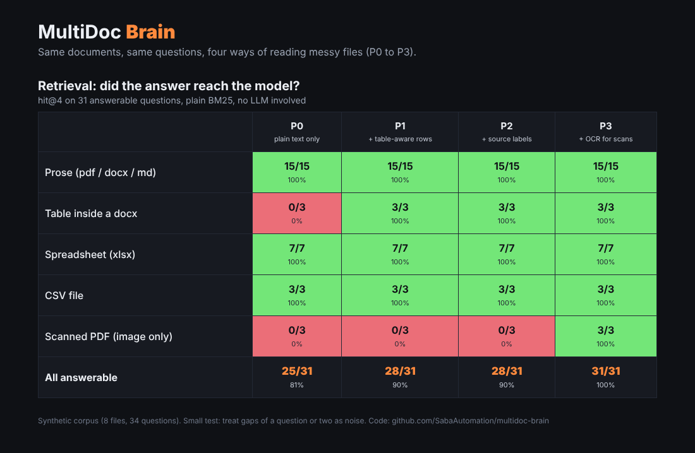

# MultiDoc Brain

**How much does the way you read messy files change what a small local AI can answer?**

Most RAG demos use clean text. Real client files are Word tables, spreadsheets, CSVs and scanned PDFs.
MultiDoc Brain is a measured experiment: the same documents, the same 34 questions and the same free local model
(`qwen2.5-coder:7b` on a laptop CPU, through Ollama), with four ways of reading the files (P0 to P3). No paid API.





## The four reading levels

| Level | What it does |
|---|---|
| **P0** | Plain text only. Word tables dropped, spreadsheet rows as bare values, scans unreadable |
| **P1** | Table-aware: rows become `Header: value \| Header: value` |
| **P2** | P1 + every chunk labelled `[file \| sheet / page / table]` |
| **P3** | P2 + OCR (Tesseract) for pages with no text layer |

P0 is a deliberately naive baseline that I defined. It is not a claim about any one library.

## Results

### Model answers (qwen2.5-coder:7b, 31 answerable questions, 1 run per cell)

| File type | P0 | P1 | P2 | P3 |
|---|---|---|---|---|
| Prose (pdf / docx / md) | 15/15 | 15/15 | 15/15 | 15/15 |
| Table inside a docx | 0/3 | 3/3 | 3/3 | 3/3 |
| Spreadsheet (xlsx) | 5/7 | 5/7 | 7/7 | 7/7 |
| CSV | 3/3 | 3/3 | 3/3 | 3/3 |
| Scanned PDF | 0/3 | 0/3 | 0/3 | 3/3 |
| **All answerable** | **23/31** | **26/31** | **28/31** | **31/31** |

The 3 trap questions (the answer is not in any file, so the right reply is `NOT FOUND`): the model refused correctly **3/3 at every level**.

### Retrieval (did the answer reach the model? hit@4, no LLM involved)

| Level | P0 | P1 | P2 | P3 |
|---|---|---|---|---|
| All answerable | 25/31 | 28/31 | 28/31 | 31/31 |

### What I found
- **How the files are read decides whether the answer even reaches the model.** Tables in a Word file: 0/3 with plain text, 3/3 once rows keep their headers. Scanned PDF: 0/3 until OCR, then 3/3.
- **The model answered everything that was put in front of it at P2 and P3** (28/31 and 31/31, equal to retrieval).
- **Spreadsheets were the odd one out.** At P0 and P1 the answer was retrieved for all 7 questions, but the model got only 5 of 7 right. With source labels (P2) it got 7/7. I have not inspected why, and it is one run, so this may be noise. It is the first thing I would repeat.
- On this test the model did not guess when the answer was missing.

### What this does and does not show
- Small synthetic corpus (8 invented files, 34 questions). A gap of one or two questions is noise.
- Retrieval is keyword search (BM25). Embeddings could behave differently.
- One run per cell on a small model. Repeat before trusting any single difference.
- The files are cleaner than real client files.

## Quick start (Windows PowerShell)

```powershell
python -m venv venv
.\venv\Scripts\Activate.ps1
pip install -r requirements.txt
python selfcheck.py                       # 29 checks, no Ollama needed
python run_experiment.py                  # retrieval results in seconds
python run_experiment.py --answer         # ask the local model (slow on CPU, resumable)
python make_report.py
python make_dashboard.py                  # then open results\dashboard.html
```

One click: `powershell -ExecutionPolicy Bypass -File .\setup_and_run.ps1` (add `-Answer` to include the model).

Model: `ollama pull qwen2.5-coder:7b`. Any Ollama model works with `--model`.

### Optional: OCR for scanned files (level P3)
Install Tesseract, for example `winget install UB-Mannheim.TesseractOCR`. Without it, P3 cannot read scans and equals P2.

## Use it on your own files
```powershell
python ask.py --docs "C:\path\to\your\folder" --level P3
```
Supports `.pdf .docx .xlsx .csv .md .txt`. Answers come with the source file and sheet or page.

## Project layout
```
mdbrain/        parsers (P0-P3), chunking, BM25, pipeline, scoring, Ollama client
corpus/         8 invented files + questions.json (answers known)
tools/          make_corpus.py regenerates the corpus
results/        retrieval.csv, answers.csv, REPORT.md, dashboard.html
run_experiment.py  make_report.py  make_dashboard.py  ask.py  selfcheck.py
docs/HOW_IT_WORKS.md
```

## License
MIT